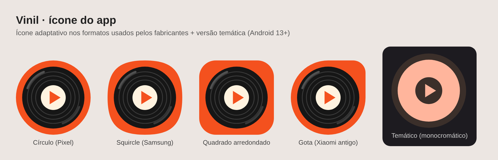

# Vinil



Tocador de música para Android, nativo, em **Kotlin + Jetpack Compose + Media3 (ExoPlayer)**.

## Funcionalidades

- Lista as músicas salvas no aparelho (MediaStore), com capa, artista, álbum e duração
- Tela "Tocando agora" com barra de progresso, aleatório e repetir (desligado / tudo / uma)
- Mini player na parte de baixo da biblioteca
- **Reprodução em segundo plano** com notificação, controles na tela de bloqueio e botões de fones Bluetooth
- Pausa automaticamente em ligações (foco de áudio) e ao desconectar o fone
- Busca por voz ("Ok Google, tocar ... no Vinil"), inclusive no Android Auto
- **Android Auto**: navegação por "Todas as músicas" e "Álbuns" direto na central do carro
- Material You (cores do papel de parede) no Android 12+, tema claro e escuro

## Requisitos

- Android 7.0 (API 24) ou superior no aparelho
- Android Studio (Ladybug ou mais recente) com JDK 17

## Como rodar

1. Abra a pasta do projeto no Android Studio e aguarde a sincronização do Gradle.
2. Conecte um aparelho (ou crie um emulador) e clique em **Run**.

Pela linha de comando:

```bash
./gradlew assembleDebug        # gera app/build/outputs/apk/debug/app-debug.apk
./gradlew installDebug         # instala no aparelho conectado
./gradlew testDebugUnitTest    # testes unitários
```

O GitHub Actions (`.github/workflows/android.yml`) compila o projeto a cada push e publica o APK de debug como artefato.

### Testando no Android Auto

Instale o **Desktop Head Unit (DHU)** pelo SDK Manager, ative o modo desenvolvedor no app Android Auto
do celular, habilite "Fontes desconhecidas" e inicie o DHU. Como o app ainda não está na Play Store,
o Android Auto só o exibe com "Fontes desconhecidas" habilitado.

## Estrutura

```
app/src/main/java/io/github/viniciusxpg/vinil/
├── MainActivity.kt              # ponto de entrada (Compose)
├── data/
│   ├── Song.kt                  # modelos Song e Album
│   └── MusicRepository.kt       # leitura do MediaStore + cache
├── playback/
│   ├── PlaybackService.kt       # MediaLibraryService: ExoPlayer, notificação, Android Auto
│   ├── MediaIds.kt              # IDs da árvore de navegação (root / songs / albums)
│   └── MediaItems.kt            # conversão Song/Album -> MediaItem
├── ui/
│   ├── VinilApp.kt         # permissões e navegação entre telas
│   ├── PlayerViewModel.kt       # MVVM: MediaController -> StateFlow
│   ├── components/              # AlbumArt, MiniPlayer
│   ├── screens/                 # Library, NowPlaying, Permission
│   └── theme/                   # tema Material 3
└── util/                        # permissões, formatação de tempo
```

### Arquitetura

```
Compose UI ──> PlayerViewModel ──MediaController──> PlaybackService (MediaLibrarySession + ExoPlayer)
                     │                                       │
                     └──────────> MusicRepository <──────────┘
                                  (MediaStore)
```

A interface nunca toca o ExoPlayer diretamente: ela fala com o serviço pelo `MediaController`,
da mesma forma que a notificação, o relógio e o Android Auto. Por isso a música continua tocando
com o app fechado e todos os controles ficam sincronizados.

## Próximos passos

- Playlists salvas localmente (Room)
- Abas de artistas e pastas
- Busca
- Retomar a última música ao abrir o app (playback resumption)
- Equalizador
